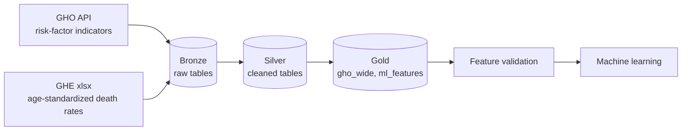

# Data Health FTW

**English** | [Português (BR)](README.pt-BR.md)

End-to-end Databricks pipeline with a medallion architecture on WHO health data (GHO indicators and Global Health Estimates), with machine learning models for cardiovascular and respiratory mortality.


## Goal

Measure how risk factors such as air pollution (PM2.5), smoking, obesity, sanitation and public health spending relate to **age-standardized death rates** from cardiovascular and respiratory causes across countries, and build models that predict those rates.

The project is a data engineering + ML portfolio piece: ingestion, cleaning, feature engineering, validation and modelling all run on Databricks.

## Architecture



Job `ml_features_pipeline`:

`ghe-bronze-ingest` → `ghe-silver-transform` → `ml-features-build` → `ml-features-validate`

| Layer | Table | Content |
|---|---|---|
| Bronze | `workspace.bronze.ghe_asdr_raw` | Raw GHE death rates from the xlsx file |
| Silver | `workspace.silver.ghe_asdr_clean` | Tidy country x year x cause table |
| Gold | `workspace.gold.gho_wide` | GHO indicators, one row per country and year |
| Gold | `workspace.gold.ml_features` | GHE targets left-joined with `gho_wide` (1,480 rows) |

## Data sources

| Source | Used for | Notes |
|---|---|---|
| [WHO GHO OData API](https://www.who.int/data/gho/info/gho-odata-api) | Risk-factor indicators (PM2.5, smoking, obesity, ...) | Being deprecated by WHO. It returned HTTP 500 on 2026-10-30. |
| WHO Global Health Estimates 2023 (xlsx) | Age-standardized death rates per 100,000 by cause, sex and country | Years available: 2000, 2010, 2015, 2019, 2020, 2021, 2022, 2023 |
| [WHO Xmart API](https://xmart-api-public.who.int/refmart/$metadata) | Replacement for the GHO API | **Planned**, still being evaluated |

Panel size: up to 185 countries x 8 years = 1,480 rows. The modelling window is 2010-2023 (1,295 rows).

## Engineering decisions

- **API deprecation.** The GHO OData API is being discontinued, so cause-of-death targets come from the GHE file instead. Migrating the indicator ingestion to the Xmart API is the next step.
- **No target leakage.** `ncd_mortality_30_70` (contains the target causes), `life_expectancy` and `healthy_life_expectancy` are excluded. Pollution-attributable mortality is not used as a target because it is computed from the same exposures used as features.
- **Sparse features dropped.** `child_stunting_prev` (70-87% null every year), `high_glucose_prev` (only 2000 and 2010), `hypertension_prev` (only up to 2019), and `mdg_indicator` / `hiv_indicator` (~25% null and vague definitions).
- **Modelling window starts in 2010.** `pm25_exposure` is 100% null in 2000.
- **Gaps in `smoking_prev`.** 2019 and 2021 are fully missing, so the last observed value is carried forward within each country (past values only, to avoid leakage).
- **`year` is not a feature.** Alone it explains about 1% of the variance (log scale) while country explains about 95%, and it cannot extrapolate to unseen years. A grouped-CV comparison with and without `year` is planned to confirm this.

## Machine learning

- **Targets:** `cvd_asdr` (cardiovascular, GHE 1100; `ihd_asdr` as a narrower alternative) and `chronic_resp_asdr` (COPD + asthma). Sensitivity checks use COPD alone and total respiratory diseases (1170).
- **Validation:** `GroupKFold` by country (and by region group). A random row split would put the same country in both train and test, because countries change little between years, which inflates the metrics.
- **Models:** simple baseline vs. final model, compared in a metrics table, plus feature importance.
- **Experiment tracking:** MLflow (planned).
- **Limitations:**
  - Only 8 years of data per country.
  - Country-level (ecological) data, so findings do not apply to individuals.
  - Correlation is not causation.

## Repository structure

```text
.
├── common/config.py                 # ML_* constants and shared config
├── src/data_health_ftw/ml/          # ML code
└── notebooks/01_eda_and_baseline.py # EDA and baseline model
```

1. Upload `age-standardized-death-rates-2000-2023_bycountry_2026-10-01.xlsx` to the volume above.
2. Deploy and run the job `ml_features_pipeline`.
3. Open `notebooks/01_eda_and_baseline.py` to explore the features and train the baseline.

## Roadmap

- [ ] Migrate indicator ingestion from the GHO API to the Xmart API
- [ ] Compare grouped-CV metrics with and without `year`
- [ ] Baseline vs. final model, with feature importance
- [ ] Track experiments with MLflow
- [ ] Add results and insights to this README

## Author

Gabriel · [GitHub](https://github.com/akira-gabriel)
