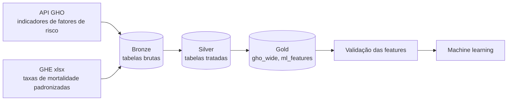

# Data Health FTW

[English](README.md) | **Português (BR)**

Pipeline construido no Databricks, utilizando arquitetura medallion, sobre dados de saúde da OMS (indicadores do GHO e Global Health Estimates), com modelos de machine learning para predizer mortalidade cardiovascular e respiratória.

## Objetivo

Verificar quanto fatores de risco como poluição do ar (PM2.5), tabagismo, obesidade, saneamento e gasto público em saúde se relacionam com as taxas de mortalidade padronizadas por idade por causas cardiovasculares e respiratórias entre países, e construir modelos que prevejam essas taxas.

É um projeto engenharia de dados com machine learning seguindo a pipeline com ingestão, limpeza, engenharia de features, validação e modelagem nativo no Databricks.

## Arquitetura

Job `ml_features_pipeline`:

`ghe-bronze-ingest` → `ghe-silver-transform` → `ml-features-build` → `ml-features-validate`

| Camada | Tabela | Conteúdo |
|---|---|---|
| Bronze | `workspace.bronze.ghe_asdr_raw` | Taxas de mortalidade do GHE, brutas, vindas do arquivo xlsx |
| Silver | `workspace.silver.ghe_asdr_clean` | Tabela organizada por país x ano x causa |
| Gold | `workspace.gold.gho_wide` | Indicadores do GHO, uma linha por país e ano |
| Gold | `workspace.gold.ml_features` | Targets do GHE com left join em `gho_wide` (1.480 linhas) |

## Fontes de dados

| Fonte | Uso | Observações |
|---|---|---|
| [API OData do GHO (OMS)](https://www.who.int/data/gho/info/gho-odata-api) | Indicadores de fatores de risco (PM2.5, tabagismo, obesidade, ...) | Foi descontinuada pela OMS. Retornou com HTTP 500 em 30/10/2026. |
| WHO Global Health Estimates 2023 (xlsx) | Taxas de mortalidade padronizadas por idade, por 100.000, por causa, sexo e país | Anos disponíveis: 2000, 2010, 2015, 2019, 2020, 2021, 2022, 2023 |
| [API Xmart (OMS)](https://xmart-api-public.who.int/DATA_/$metadata) | Substituta da API GHO (entidades `RELAY_*` + `REFMART.REF_COUNTRY` para M49 → ISO-3 e região) | **Em uso** no ingest bronze |

Tamanho do painel: até 185 países x 8 anos = 1.480 linhas. A janela de modelagem é 2010-2023 (1.295 linhas).

## Decisões de engenharia

- **Descontinuação da API.** A API OData do GHO foi descontinuada, os targets de causa de morte vêm do arquivo GHE e os indicadores agora são ingeridos da API Xmart da OMS. O Xmart marca algumas séries como `DRAFT` (obesidade, desnutrição infantil e as de gasto em saúde). Os valores de obesidade foram conferidos com os dados antigos e são idênticos.
- **Sem vazamento de target (target leakage).** `ncd_mortality_30_70` por contarem o próprio target, assim como `life_expectancy` e `healthy_life_expectancy` ficam de fora. A mortalidade atribuível à poluição não é usada como target porque é calculada a partir das mesmas exposições usadas como features.
- **Features esparsas descartadas.** `child_stunting_prev` (70-87% nulos em todos os anos), `high_glucose_prev` (só 2000 e 2010), `hypertension_prev` (só até 2019) e `mdg_indicator` / `hiv_indicator` (~25% nulos e definições vagas).
- **Feature de gasto derivada.** `gov_health_spend_per_capita_usd` não é mais publicada pelo Xmart, então é reconstruída como gasto corrente em saúde per capita (US$) vezes a fração do gasto governamental doméstico no gasto corrente (ambos em moeda nacional). Conferida com os valores antigos: diferença média absoluta de 0,02 US$ sobre uma média de 675 US$.
- **Estimativas de tabagismo revisadas.** `smoking_prev` difere pouco dos valores antigos, a diferença média absoluta de cerca de 1 ponto percentual, concentrada em poucos países, sem viés sistemático, a série inclui projeções da OMS para 2025 e 2030.
- **A janela de modelagem começa em 2010.** `pm25_exposure` é 100% nulo em 2000.
- **Lacunas em `smoking_prev`.** 2019 e 2021 estão totalmente ausentes, então o último valor observado é propagado dentro de cada país (apenas valores do passado, para evitar vazamento que prejudicaria os modelos de machine learning).

## Machine learning

- **Targets:** `cvd_asdr` (cardiovascular, GHE 1100; `ihd_asdr` como alternativa mais estreita) e `chronic_resp_asdr` (DPOC + asma). As checagens de sensibilidade usam só DPOC e o total de doenças respiratórias (1170).
- **Validação:** `GroupKFold` por país (e por grupo de região). Uma divisão aleatória das linhas colocaria o mesmo país no treino e no teste, já que os países mudam pouco de um ano para o outro, o que infla as métricas.
- **Modelos:** baseline simples vs. modelo final, comparados em uma tabela de métricas, mais a importância das variáveis.
- **Rastreamento de experimentos:** MLflow (planejado).
- **Limitações:**
  - Apenas 8 anos de dados por país.
  - Dados agregados por país, então as conclusões não se aplicam a indivíduos.
  - Correlação não é causalidade, logo não se deve presumir nenhum argumento causal

## Roadmap

- ✅ Migrar a ingestão dos indicadores da API GHO para a API Xmart
- ⬜ Comparar métricas de CV agrupada com e sem `year`
- ⬜ Baseline vs. modelo final, com importância das variáveis
- ⬜ Rastrear experimentos com MLflow
- ⬜ Adicionar resultados e insights a este README